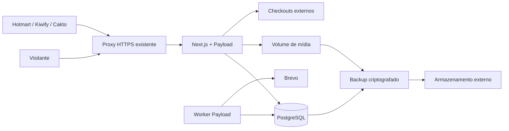

# 04 — Arquitetura

[Índice](../README.md) · [Decisões](17-decisoes.md) · [Infraestrutura](10-infraestrutura.md)

## Estrutura

Monólito modular em TypeScript: Next.js App Router entrega páginas e rotas; Payload oferece administração, autenticação, coleções e jobs; PostgreSQL armazena conteúdo e operação. Tailwind implementa apresentação. Sem IA, Redis ou microserviços.

Arquitetura do produto completo; o diagrama inclui integrações e infraestrutura ainda não homologadas. Implementação existente, versões fixadas e lacunas estão no [estado atual](23-estado-atual.md). Adaptadores e endpoints Hotmart/Kiwify/Cakto existem localmente em D63–D65; inbox/processador/histórico e filas de relacionamento também existem. Conciliação inclui lotes D67/D77, decisões/evidências D72–D75, ledger D78 e views suportadas do Payload D79–D81, incluindo registro/correção de liquidações/custos. Essas interfaces reutilizam autenticação e serviços existentes, sem novo serviço, biblioteca, migration ou integração externa. Nenhum adaptador comercial nativo foi habilitado para operação real.

## Versões e dependências

A base já fixa Node 22.23.3 na imagem/CI, pnpm 10.34.7, Next 16.4.2, Payload 3.91.0 e PostgreSQL 17.9 por digest. O lockfile e os patches locais fazem parte da revisão validada D127. Em atualizações, consultar a matriz oficial, avaliar advisories e renovar os gates afetados. Não tratar “mais recente” como prova de compatibilidade. A documentação consultada do Payload explicita faixas de Next suportadas; validar novamente antes de instalar ([fonte](https://payloadcms.com/docs/getting-started/installation)).

## Organização do código

- `src/app/(site)`: páginas públicas; `src/app/(payload)`: painel e infraestrutura Payload.
- `src/collections` e `src/access`: coleções e permissões.
- `src/modules/catalog`, `marketing`, `commerce`: regras independentes da apresentação.
- `src/integrations/{hotmart,kiwify,cakto,brevo}`: adaptadores externos.
- `src/jobs`: processamento assíncrono; `src/components`: componentes visuais.
- `tests`: unitários, integração e navegador; `migrations`: migrações versionadas.

Aplicação, coleções, módulos, jobs, componentes, testes e migrations já existem. Em src/integrations existe o namespace brevo com clientes/callback locais; Hotmart, Kiwify e Cakto possuem namespaces/adaptadores locais D63–D65, sem homologação externa. D61 liga o domínio D60 a inbox/histórico/projeção persistidos. D66–D67 acrescentam prévia e confirmação CSV limitada para inbox. Resolução de divergências, liquidação, custos e relatórios financeiros continuam pendentes de B11.

## Leitura, publicação e cache

Páginas públicas usam renderização dinâmica no servidor e projeções diretas no PostgreSQL, sem cache compartilhado de HTML implementado. Publicação/alteração tem efeito na próxima leitura; sitemap também é dinâmico. Qualquer cache futuro só pode conter dados públicos e deve invalidar as dependências de publicação/alteração/remoção. O redirecionamento consulta sempre a oferta atual. Preview e contexto de campanha são privados/no-store; cookies do admin nunca entram em cache compartilhado.

Endpoints públicos retornam projeções explícitas, não a coleção completa. Na Local API do Payload, informar usuário e política de acesso explicitamente; evitar depender de defaults que podem mudar. Overrides são exclusivos de serviços internos estreitos e testados.

## Escrita e jobs

Receber webhook: autenticar → validar envelope → persistir evento mínimo durável → responder → worker mapeia catálogo e aplica transação. Inbox no banco é a fonte durável; dispatcher recupera eventos pendentes mesmo se a criação do job falhar. Operações comerciais usam transação e chave única.

Um worker na mesma imagem da aplicação, concorrência inicial 1. Polling de pendências a cada 30 segundos; rotina diária de retenção parcial implementada, opt-in com DATA_RETENTION_ENABLED=false por padrão. Jobs de e-mail solicitado usam APIs Payload sem executor público. Repetição transacional: 1, 5, 30 minutos e 2 horas; após cinco tentativas totais, falha visível para intervenção. Timeout incerto exige conciliação, sem repetição cega. Calendário promocional só prepara elegibilidade; não dispara campanha. Inbox comercial e observação Brevo possuem implementação local; homologação e cobertura integral continuam pendentes.

## Ambientes

Desenvolvimento local com dados sintéticos; homologação isolada com e-mails de teste e fixtures; produção com domínio e credenciais próprios. Nunca copiar compradores reais para testes. O workflow CI presente prepara verificações/build/testes HTTP, sem execução comprovada no GitHub e sem etapa de imagem/browser configurada. O fluxo original constrói a imagem fora da VPS; D46 acrescenta o fluxo clone/build no host solicitado pelo proprietário, com inventário/capacidade e tag local exclusiva/ID verificado. Ambos exigem homologação antes de release. Migrations são revisadas e executadas uma vez por release; produção não usa sincronização automática de schema.

## Alternativas

Astro + arquivos seria menor para vitrine estática, mas não atende tão diretamente ao painel manual e eventos comerciais. Frontend e backend separados ampliariam operação sem benefício inicial. O CMS integrado atende conteúdo e administração sem impedir evolução posterior.

## Camada visual especificada

[Briefing](../DESIGN-BRIEF.md) e [tokens](design/02-tokens.md) governam apresentação. Implementar tokens semânticos via CSS custom properties, Tailwind para consumo e adapter separado para Payload. Fontes WOFF2 locais com fallback; motion com CSS/WAAPI, sem biblioteca adicional obrigatória.

O site aplica tema antes do paint, com CSS system fallback e bootstrap compatível com CSP. O painel integra a preferência ao provider suportado do Payload, sem duas autoridades concorrentes. O tema não modifica texto renderizado, contratos comerciais ou chave de cache de páginas públicas. Não criar cookie de identificação; preferência funcional em storage local com fallback seguro.

Rota pública de captura `/amostras/[slug]` reutiliza POST `/api/v1/lead-requests`. Os campos de apresentação são enumerados e publicados pelo CMS, não código executável. Bibliotecas, frontend e migrações foram criados na implementação posterior à entrega documental inicial; evidências e limites no mapa vigente.

## Inbox comercial local — D61

O receptor interno prepara/verifica o adaptador antes de abrir a transação. Persiste envelope normalizado, impressão, versão e auditoria juntos; retorna received somente após commit. Dispatcher é uma consulta limitada ao PostgreSQL pelo worker existente, sem broker adicional. Processamento usa lease de cinco minutos, token de tentativa, locks por evento/transação/produto e commit único de fato/projeção/auditoria. O catálogo compartilha o lock de identidade com edição de ofertas.

COMMERCIAL_EVENTS_ENABLED=false desliga fila/CLI por padrão. Worker pode operar somente a inbox, sem SMTP ou chave Brevo. Coleções privadas podem ser consultadas pelo owner, mas mutações REST/Local API são negadas; retry usa ação autenticada própria e não substitui o envelope. Recepção nativa pública e atribuição de compra dependem de B08–B10; financeiro, retenção e release continuam parciais. Ver [integrações](07-integracoes.md).

## Recepção Hotmart — D63

Rota nativa v2 autentica antes de ler corpo limitado e antes de resolver Payload; fábrica de acesso só é chamada após normalização válida. Inbox/auditoria no PostgreSQL continua fonte durável e worker existente aplica a projeção, sem nova fila externa. Hottok é configuração privada exclusiva do app; processamento de envelopes já recebidos não depende do token no worker. Nenhuma coluna/migração nova; evidências opcionais no JSON preservam digest legado. [Contrato Hotmart](integracoes/hotmart.md) registra fontes, semântica, flags, revisão e limites.

## Recepção Cakto V2 — D65

Pipeline comercial aceita batch nativo explícito além do caminho individual. Assinatura e normalização de todos os itens precedem a abertura do banco; recibos/colisões/auditorias do lote compartilham transação e locks ordenados. ACK só após commit integral; aplicação financeira continua assíncrona pelo worker existente. Sem broker, nova tabela, migração ou serviço. [Contrato e limites Cakto](integracoes/cakto.md).

## Conciliação durável — D67

Três coleções privadas para lote, linhas e auditoria, com confirmação atômica para a inbox existente. Prévia continua separada/somente de leitura. Barreira por conta antes dos demais locks compartilhada pelos escritores do catálogo/histórico; SQL parametrizado em blocos após validação, sem serviço/fila externos. Aplicação segue pelo worker comercial, sem token de fornecedor. [Decisão e limites](24-conciliacao.md).

## Extensão operacional de identidade — D82

View owner `/admin/catalog-resolutions` reutiliza o template do Payload e os contratos transacionais D72. Prévia/decisão continuam no servidor, com barreira de conta, hash e chave idempotente; o navegador conserva o envelope em memória para repetição. Leitura de histórico respeita a política da coleção. Nenhuma migration, dependência, serviço ou integração foi adicionada; são 28 migrations. A seleção/aplicação de fontes financeiras permanece em sua API existente e aguarda interface própria.

## Interface financeira auditada — D83

View owner `/admin/financial-resolutions` reutiliza os contratos D73–D75 e o template Payload. Busca inicial é prévia hold sem escrita para obter o componente inteiro; não registra bloqueio. Seleção explícita de cada fonte/variante precede outra prévia e a decisão transacional existente. Histórico/detalhe consultam coleções privadas; cabeças mais recentes são lidas pelo helper interno após verificar owner. GET não aplica decisão. Nenhuma migration, dependência, serviço, segredo ou flag nova.

## Snapshot de cobertura financeira — D84

A prévia continua em transação PostgreSQL REPEATABLE READ READ ONLY. Consulta inclui candidatas pagas ou em revisão, mantendo quarentena fora dos valores confirmados. Cobertura por moeda é calculada no próprio grupo; caixa/custos mantêm janela independente e substituições são resolvidas antes do filtro temporal. Módulo puro financial-report-cohort calcula somente cobertura, taxa observável e idade sem janela presumida. Sem novo serviço, schema, dependência ou integração.

## Detalhamentos e processamento — D85

Snapshot mantém REPEATABLE READ READ ONLY. Agregação pura por livro/provedor/campanha usa transações na janela de aprovação, movimentos de caixa e custos em suas janelas. Metadados de transações de caixa aprovadas fora da janela são lidos em blocos de 200 para alocação; títulos/códigos atuais são rótulos. Sem nova tabela, migration, serviço, dependência, segredo ou flag.

Livro efetivo prevalece sobre original quando o vínculo está conferido. Caixa com alocação em revisão/ausente/moeda divergente fica sem livro conferido; valor do movimento é preservado. Custos somente usam campanha declarada; não ratear por provedor/livro nem inferir receita. lastSuccessAt vem dos processadores existentes, separado da observação da consulta e da data do evento.

## Aceite integrado sem mudança de aplicação — D86

Matriz PostgreSQL percorre sete estados por provedor nos contratos existentes: preview sem escrita, stage durável, commit de prova e decisão/aplicação separados. Jornada de navegador conecta importação, resolução de catálogo, decisão financeira, caixa/custo e relatório. Fontes da aplicação foram conferidas contra as hashes do build D85, reutilizado; somente testes/harness/runner/documentação mudaram. Sem nova arquitetura, schema/migration, segredo, flag ou integração.

## Retenção de identidade — D110

O worker integra retenção de identidades encerradas, com transação e locks compartilhados com captura/promoções. Fatos automáticos HMAC de 24 meses ficam separados de solicitações humanas; replay v3 preserva nova finalidade e mantém dependências antigas em quarentena. Schema vigente: 33 migrations; imagem final e recuperação externa continuam pendentes. Contratos em [privacidade](12-seguranca-privacidade.md).

## D111 — Operações em lote e diagnóstico PostgreSQL — 26/10/2026

O patch versionado `patches/payload@3.91.0.patch` serializa atualização/exclusão em lote quando há transactionID compartilhado: uma transação usa um único cliente PostgreSQL. Exclusão passa a iniciar cada documento depois do anterior, sem apenas aguardar promises já iniciadas. O caminho sem transação preserva concorrência; não introduz mutex global nem muda locks/regras de domínio. Mantém a proteção anterior de exclusão diferida de arquivos.

## D112 — Descadastro e retenção por assunto — 26/10/2026

theme-withdrawals guarda fato por subjectFingerprint HMAC + UUID estável do assunto, sem FK/email/ator owner. O descadastro e seu fato são atômicos sob o lock do contato; a chave do fato serializa upsert/expiração. Retenção temática e replay usam promotion-batches → contact → theme-withdrawal. Confirmação consulta o fato sob o lock do contato mesmo sem assinatura; somente pedido posterior ao descadastro pode conceder marketing. Não introduz serviço ou provedor adicional.

## D113 — Margem e acompanhamento do prazo — 26/10/2026

retention-policy centraliza elegibilidade de 28 dias, meta máxima de 30 dias e frescor operacional de 25 horas. O worker continua a executar diariamente por dia UTC; 28 dias + 25 horas deixam 23 horas de margem matemática antes dos 30 dias, condicionada à operação saudável. A conclusão do ciclo publica arquivo privado de saúde atomicamente; falha não avança o dia executado. Health distingue processo vivo de tarefa atrasada ou com assinaturas para revisão. Não introduz serviço, flag ou tabela.

## D114 — Legado temático verificável — 26/10/2026

legacy-theme-withdrawal deriva somente de assinatura canônica e evento interno consistente; não busca provedor nem usa aparência do estado como data. Backfill é transacional por contato, com lock contact → theme-withdrawal. Retenção direta também consegue persistir o fato no mesmo commit que retira a assinatura. Exportação usa snapshot REPEATABLE READ READ ONLY e pode compor o fato assinado sem persistir nada no banco. O formato permanece v4, sem tabela/serviço novo.

## Ponte editorial local → remoto

Cliente no Bibliotheon, lançador mínimo no projeto ebooks e pacote portátil por título. API autenticada reutiliza Payload/owner e PostgreSQL; sem novo serviço, dependência paga ou IA no produto. Duas tabelas SQL internas controladas por migration guardam vínculo/base e recibos. [Contrato](integracoes/editorial.md).
