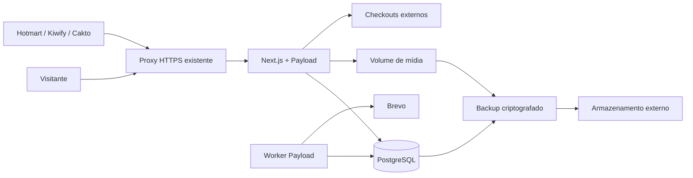

# 04 — Arquitetura

[Índice](../README.md) · [Decisões](17-decisoes.md) · [Infraestrutura](10-infraestrutura.md)

## Estrutura

Monólito modular em TypeScript: Next.js App Router entrega páginas e rotas; Payload oferece administração, autenticação, coleções e jobs; PostgreSQL armazena conteúdo e operação. Tailwind implementa apresentação. Sem IA, Redis ou microserviços.

Arquitetura do produto completo; o diagrama inclui integrações e infraestrutura ainda não homologadas. Implementação existente, versões fixadas e lacunas estão no [estado atual](23-estado-atual.md). O diagrama inclui operação externa ainda não homologada. Adaptadores e endpoints Hotmart/Kiwify/Cakto existem localmente em D63–D65; lotes CSV limitados foram acrescentados em D67. Inbox/processador/histórico comerciais comuns existem localmente em D61, além das filas de relacionamento; nenhum adaptador comercial nativo foi habilitado.

## Versões e dependências

Usar Node LTS suportado simultaneamente por Payload/Next, pnpm, releases estáveis compatíveis e PostgreSQL 17 como baseline planejada. No B01, consultar matriz oficial, escolher patches corrigidos, registrar versões exatas, gerar lockfile e fixar imagens por digest. Não tratar “mais recente” como prova de compatibilidade. A documentação consultada do Payload explicita faixas de Next suportadas; validar novamente antes de instalar ([fonte](https://payloadcms.com/docs/getting-started/installation)).

## Organização do código

- `src/app/(site)`: páginas públicas; `src/app/(payload)`: painel e infraestrutura Payload.
- `src/collections` e `src/access`: coleções e permissões.
- `src/modules/catalog`, `marketing`, `commerce`: regras independentes da apresentação.
- `src/integrations/{hotmart,kiwify,cakto,brevo}`: adaptadores externos.
- `src/jobs`: processamento assíncrono; `src/components`: componentes visuais.
- `tests`: unitários, integração e navegador; `migrations`: migrações versionadas.

Aplicação, coleções, módulos, jobs, componentes, testes e migrations já existem. Em src/integrations existe o namespace brevo com clientes/callback locais; Hotmart, Kiwify e Cakto possuem namespaces/adaptadores locais D63–D65, sem homologação externa. D61 liga o domínio D60 a inbox/histórico/projeção persistidos. D66–D67 acrescentam prévia e confirmação CSV limitada para inbox. Resolução de divergências, liquidação, custos e relatórios financeiros continuam pendentes de B11.

## Leitura, publicação e cache

Páginas públicas usam renderização dinâmica no servidor e projeções diretas no PostgreSQL, sem cache compartilhado de HTML implementado. Publicação/alteração tem efeito na próxima leitura; sitemap também é dinâmico. Qualquer cache futuro só pode conter dados públicos e deve invalidar as dependências de publicação/alteração/remoção. O redirecionamento consulta sempre a oferta atual. Preview e contexto de campanha são privados/no-store; cookies do admin nunca entram em cache compartilhado.

Endpoints públicos retornam projeções explícitas, não a coleção completa. Na Local API do Payload, informar usuário e política de acesso explicitamente; evitar depender de defaults que podem mudar. Overrides são exclusivos de serviços internos estreitos e testados.

## Escrita e jobs

Receber webhook: autenticar → validar envelope → persistir evento mínimo durável → responder → worker mapeia catálogo e aplica transação. Inbox no banco é a fonte durável; dispatcher recupera eventos pendentes mesmo se a criação do job falhar. Operações comerciais usam transação e chave única.

Um worker na mesma imagem da aplicação, concorrência inicial 1. Polling de pendências a cada 30 segundos; rotina diária de retenção ainda pendente. Jobs de e-mail solicitado usam APIs Payload sem executor público. Repetição transacional: 1, 5, 30 minutos e 2 horas; após cinco tentativas totais, falha visível para intervenção. Timeout incerto exige conciliação, sem repetição cega. Calendário promocional só prepara elegibilidade; não dispara campanha. Jobs comerciais e observação integral continuam previstos.

## Ambientes

Desenvolvimento local com dados sintéticos; homologação isolada com e-mails de teste e fixtures; produção com domínio e credenciais próprios. Nunca copiar compradores reais para testes. O workflow CI presente prepara verificações/build/testes HTTP, sem execução comprovada no GitHub e sem etapa de imagem/browser configurada. O fluxo original constrói a imagem fora da VPS; D46 acrescenta o fluxo clone/build no host solicitado pelo proprietário, com inventário/capacidade e tag local exclusiva/ID verificado. Ambos exigem homologação antes de release. Migrations são revisadas e executadas uma vez por release; produção não usa sincronização automática de schema.

## Alternativas

Astro + arquivos seria menor para vitrine estática, mas não atende tão diretamente ao painel manual e eventos comerciais. Frontend e backend separados ampliariam operação sem benefício inicial. O CMS integrado atende conteúdo e administração sem impedir evolução posterior.

## Camada visual especificada

[Briefing](../DESIGN-BRIEF.md) e [tokens](design/02-tokens.md) governam apresentação. Implementar tokens semânticos via CSS custom properties, Tailwind para consumo e adapter separado para Payload. Fontes WOFF2 locais com fallback; motion com CSS/WAAPI, sem biblioteca adicional obrigatória.

O site aplica tema antes do paint, com CSS system fallback e bootstrap compatível com CSP. O painel integra a preferência ao provider suportado do Payload, sem duas autoridades concorrentes. O tema não modifica texto renderizado, contratos comerciais ou chave de cache de páginas públicas. Não criar cookie de identificação; preferência funcional em storage local com fallback seguro.

Rota pública de captura `/amostras/[slug]` reutiliza POST `/api/v1/lead-requests`. Os campos de apresentação são enumerados e publicados pelo CMS, não código executável. Bibliotecas, frontend e migrações foram criados na implementação posterior à entrega documental inicial; evidências e limites no mapa vigente.

## Inbox comercial local — D61

O receptor interno prepara/verifica o adaptador antes de abrir a transação. Persiste envelope normalizado, impressão, versão e auditoria juntos; retorna received somente após commit. Dispatcher é uma consulta limitada ao PostgreSQL pelo worker existente, sem broker adicional. Processamento usa lease de cinco minutos, token de tentativa, locks por evento/transação/produto e commit único de fato/projeção/auditoria. O catálogo compartilha o lock de identidade com edição de ofertas.

COMMERCIAL_EVENTS_ENABLED=false desliga fila/CLI por padrão. Worker pode operar somente a inbox, sem SMTP ou chave Brevo. Coleções privadas podem ser consultadas pelo owner, mas mutações REST/Local API são negadas; retry usa ação autenticada própria e não substitui o envelope. Recepção nativa pública e atribuição de compra dependem de B08–B10; financeiro, retenção e release continuam parciais. Ver [integrações](07-integracoes.md).

## Recepção Hotmart — D63

Rota nativa v2 autentica antes de ler corpo limitado e antes de resolver Payload; fábrica de acesso só é chamada após normalização válida. Inbox/auditoria no PostgreSQL continua fonte durável e worker existente aplica a projeção, sem nova fila externa. Hottok é configuração privada exclusiva do app; processamento de envelopes já recebidos não depende do token no worker. Nenhuma coluna/migração nova; evidências opcionais no JSON preservam digest legado. [Contrato Hotmart](integracoes/hotmart.md) registra fontes, semântica, flags, revisão e limites.

## Recepção Cakto V2 — D65

Pipeline comercial aceita batch nativo explícito além do caminho individual. Assinatura e normalização de todos os itens precedem a abertura do banco; recibos/colisões/auditorias do lote compartilham transação e locks ordenados. ACK só após commit integral; aplicação financeira continua assíncrona pelo worker existente. Sem broker, nova tabela, migração ou serviço. [Contrato e limites Cakto](integracoes/cakto.md).

## Conciliação durável — D67

Três coleções privadas para lote, linhas e auditoria, com confirmação atômica para a inbox existente. Prévia continua separada/somente de leitura. Barreira por conta antes dos demais locks compartilhada pelos escritores do catálogo/histórico; SQL parametrizado em blocos após validação, sem serviço/fila externos. Aplicação segue pelo worker comercial, sem token de fornecedor. [Decisão e limites](24-conciliacao.md).
