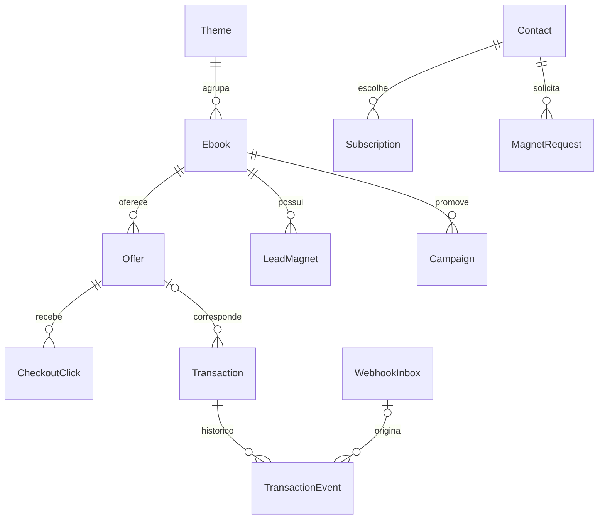

# 05 — Modelo de dados e invariantes

[Índice](../README.md) · [Interfaces](06-interfaces.md) · [Integrações](07-integracoes.md)

## Convenções

IDs internos UUID; datas em UTC, apresentação America/Belem. Valores monetários em centavos inteiros com moeda ISO (`BRL` inicialmente). Quantia desconhecida é `null`, nunca zero. Strings externas são opacas, sem conversão numérica. Todas as entidades têm createdAt/updatedAt. Slugs minúsculos ASCII com hífens, únicos no tipo.

Modelo lógico de referência. Parte já está mapeada em coleções e migrações; estado e evidências em [desenvolvimento](19-desenvolvimento.md). Relações e índices devem existir no banco, não depender só do formulário.

Na revisão de 21/10/2026 existem coleções editoriais, Campaign, Redirects, SiteSettings, contatos/consentimento, pedidos/outbox, tokens, limites/quota, EmailSequence, SequenceEnrollment, PromotionDelivery e, desde 22/10, EmailCampaignBatch, BrevoSuppression, BrevoRegistration e BrevoBatchList locais. MarketingTask, Visit/CheckoutClick, Transaction/Event, WebhookInbox, ImportBatch/Row, CostEntry e AuditEvent genérico permanecem modelo previsto, não tabelas implementadas. A trilha de consentimento/supressão existente não substitui auditoria financeira. Ver [mapa vigente](23-estado-atual.md).

| Entidade | Campos principais e restrições |
|---|---|
| AdminUser | email único, autenticação Payload, papel único `owner`; sem inscrição pública |
| Theme | slug, nome, introdução, estado editorial |
| Ebook | slug, título, resumo, themeId, público, problema, promessa, benefícios, sumário, requisitos, limites, coverId, blocos LP, materialState (`production/ready`), estado editorial |
| Media | nome interno, MIME real, tamanho, hash, finalidade, visibilidade (`public/private`), alt; nenhum livro pago completo |
| LeadMagnet | ebookId, mediaId, título, versão, ativo; material gratuito privado entregue por link temporário |
| Article | slug, título, resumo, corpo, themeId, ebookId opcional, autor exibido, estado editorial, SEO |
| Offer | ebookId, provider, accountKey, externalProductId, externalOfferId opcional, checkoutUrl, priceCents, currency, active, primary, lastVerifiedAt, eligibilityNote |
| Campaign | código único, ebookId, offerId, público, hipótese, canal, UTMs, tipo (`owned/affiliate`), affiliateUrl opcional, estado (`draft/active/paused/closed`), datas |
| MarketingTask | campaignId, descrição, prazo, estado (`todo/doing/done`), evidenceUrl opcional |
| Contact | email normalizado único, confirmedAt opcional, globalSuppressedAt, estado de entrega (`ok/bounced/complaint`); sem CPF/telefone |
| Subscription | contactId + themeId únicos, estado (`pending/subscribed/unsubscribed`), consentVersion, timestamps |
| ConsentEvent | contactId, themeId opcional, finalidade, ação, versão do texto e instante; trilha append-only |
| MagnetRequest | contactId, magnetId, confirmationTokenHash, expiresAt, confirmedAt, deliveredAt; solicitação não implica marketing |
| EmailSequence | amostra/versão únicas, revisão inteira crescente, oferta, quatro assuntos/textos manuais, ativo e hash do conteúdo; ativação exige cópia completa e vínculos coerentes |
| SequenceEnrollment | contato/material/versão únicos, pedido, tema, sequência, confirmedAt, snapshot de revisão/conteúdo/oferta/campanha e estado; nova solicitação não reinicia sequência anterior |
| PromotionDelivery | inscrição/etapa únicas, D+2/4/7/10, dueAt fixo, nextCheckAt, estado e motivo; coleção privada, pronta indica elegibilidade local para agrupamento; referência opcional ao lote |
| EmailCampaignBatch | Implementado localmente: tema/etapa/dia previsto UTC, chave única, cópia revisada, referências de contatos/etapas e contagem de destinatários únicos, estado/timestamps e providerCheck pontual, vinculada a chave/versões locais e IDs de contatos do provedor. IDs/sincronização de lista/campanha Brevo ainda previstos |
| BrevoSuppression | fila privada única por contato, revisão, estado pending/processing/synced/failed, tentativas, lease, próxima conferência, resultado blocked/absent e códigos genéricos; sem endereço/payload/token na fila |
| BrevoRegistration | fila privada única por contato, revisão/lease/tentativas, estado pending/processing/synced/failed/canceled/canceling, versão local e ID no provedor; sem endereço/payload/token na fila |
| BrevoBatchList | manifesto privado único por lote, nome/pasta, conjunto imutável, ID externo único, lease, criação emitida, inclusões tentadas e conferência recente; sem endereços/payloads |
| EmailDelivery | chave única de pedido/etapa, contactId, providerMessageId opcional, estado, attempts, nextAttemptAt; sem corpo de mensagem nos logs |
| PreferenceToken | contactId, tokenHash único, expiresAt; finalidade de cancelamento global de marketing, 180 dias, sem token bruto persistido |
| MailQuota / RequestLimit | Quota compartilhada reservada por destinatário/dia UTC; promoções preservam capacidade transacional. Limites globais/por endereço com chave pseudonimizada e expiração de até 24h |
| Visit | id aleatório consentido, início/fim, campanha e UTMs sanitizadas; sem identidade do comprador |
| CheckoutClick | id aleatório, offerId, campaignId opcional, visitId opcional, instante, attributionAllowed; sem e-mail |
| Transaction | provider + accountKey + externalTransactionId únicos; offerId opcional, externalProductId, estado, valores, moeda, providerUpdatedAt, approvedAt, attributionClickId opcional, evidenceSource |
| TransactionEvent | transactionId, tipo normalizado, occurredAt, valor parcial se aplicável, inboxId/importRowId; histórico imutável |
| WebhookInbox | provider, accountKey, eventKey único nesse escopo, envelope mínimo validado, hash, receivedAt, status, attempts, erro sanitizado, adapterVersion |
| ImportBatch / ImportRow | autor, hash de arquivo, linhas normalizadas, prévia, status, contagens, justificativa; CSV original descartado após processamento |
| CostEntry | período, campaignId opcional, categoria, amountCents, currency, fonte, confirmado/estimado |
| AuditEvent | ator, ação, entidade/id, horário, resumo sem segredos/PII |

## Relações

## Estados e regras

Editorial: `draft → published → archived`; editar um publicado mantém revisão anterior pública até nova publicação. Uma versão em produção não pode habilitar compra. Preview autenticado pode mostrar pendências.

Oferta: publicação de CTA exige livro ready, URL revisada, preço e IDs externos. No máximo uma oferta primária ativa por livro (índice parcial e validação transacional). Desativar primária deixa compra principal indisponível até escolha explícita; não fazer rodízio automático. Moedas não suportadas não são convertidas implicitamente.

Transação: `pending`, `approved`, `refused`, `canceled`, `partially_refunded`, `refunded`, `chargeback`, `unknown`. Compra aprovada só nasce de evento autenticado mapeado ou relatório reconciliado. Cliques e abandonos não criam receita. Eventos de assinatura não anulam uma compra avulsa.

Manter valores aprovados e devolvidos separados. Valor parcial não informado não é inferido. Chargeback é estado financeiro separado e não soma uma segunda devolução por padrão. Timestamp ausente, conflito de valores ou sequência ambígua resulta em `needs_review` na inbox, preservando a transação conhecida.

Eventos anteriores ao estado conhecido entram no histórico sem regredir projeção. Reembolso recebido antes da aprovação mantém projeção de reembolso; aprovação antiga posterior não reabre receita. Mesmo timestamp com estados conflitantes exige conciliação. Identidade externa desconhecida fica em quarentena sem inventar associação ao livro.

## Índices e exclusão

Índices: slugs; provider/account/transaction; provider/account/eventKey; offer/occurredAt; campaign/occurredAt; inbox status/nextAttemptAt; subscriptions contact/theme; jobs due/status. Search simples no texto normalizado.

Livro/oferta com histórico são arquivados, não apagados em cascata. Contato pode ser excluído ou anonimizado conforme política; transação mínima não deve depender de FK para contato. IDs pseudônimos ainda exigem proteção e retenção. Ver [política](12-seguranca-privacidade.md).

## Extensão de apresentação

Campos lógicos adicionais do Ebook: `presentationVariant: guide | reading | workbook` (default guide) e `accentPreset: mineral | slate | plum` (default mineral). Validação no servidor por allowlist. `workbook` exige amostra de exercício real referenciada; capas e sumário continuam campos existentes. Ausência de campo em registros anteriores usa defaults; migração futura aditiva. Tema de assunto (`Theme`) não se confunde com aparência clara/escura.

Media acrescenta `width` e `height` extraídos do arquivo, `caption` editorial opcional, `presentationRole: cover | sample | contextual` e `focalPoint: {x,y}` opcional, normalizado 0–1, exclusivo de contextual. Alt existente continua obrigatório quando informativo. Capas e amostras preservam proporção, usam contain e ignoram crop; aplicação deve impedir ponto focal em papéis incompatíveis. Default para legado: papel segundo finalidade existente; desconhecido exige revisão antes de publicação.

A preferência `system | light | dark` não pertence ao livro nem ao comprador: fica em `bibliotheon:appearance:v1` no navegador. Não criar endpoint de perfil, tabela de aparência ou identificador de visitante para esse fim. Dados monetários, afiliados, transações e consentimento permanecem com seus contratos atuais.

## Lotes locais (D48)

Preparação limitada a 200 etapas por passagem, sob lock comum de montagem, com locks de contato em ordem. Agrupa tema, etapa, dia previsto UTC e snapshot integral da cópia (revisão, mensagens, livro, oferta e contexto de campanha). Várias etapas do mesmo destinatário dentro do lote preservam suas referências, mas contam uma vez para quota. Snapshot não contém e-mail nem token. Identidade do lote inclui o ID gerado pelo CMS, permitindo reagrupamento posterior sem colidir com lote cancelado.

Estados implementados: prepared (conjunto persistido), claimed (intenção reservada com quota), canceled e uncertain (retenção conservadora prevista para integração). Somente prepared pode ser tomado; resultado incerto não deve ser reciclado automaticamente. O claim interno revalida consentimento/material/versão/pausa e oferta comercial, usa a quota na mesma transação e muda as etapas para sending. Ainda não é invocado pelo worker; nenhum desses estados comprova envio/aceitação/entrega. Membros inelegíveis cancelam o lote inteiro sem quota e liberam vínculos para nova preparação; histórico permanece. Campos de IDs de lista/campanha e conciliação de resultado remoto pertencem à próxima etapa.

## Sincronização de bloqueios (D49)

O descadastro global e a supressão revisada persistem intenção junto da mudança local; configuração desligada não impede a fila. Uma revisão nova durante processamento não é consumida pela resposta antiga. Claim é confirmado antes do HTTP, com lease de 30 minutos; chamadas fora da transação. Retentativa de bloqueio é segura porque não envia mensagem nem reativa contatos. Timeout/429/5xx/resposta inválida mantêm pendência com backoff de 1 minuto até 6 horas; recusa definitiva fica failed até retry explícito após correção. Processamento antigo não sobrescreve lease novo.

synced com outcome blocked significa bloqueio de marketing observado naquele instante; absent significa 404 observado, sem criar contato. Não prova entrega, bloqueio transacional nem preservação futura contra alterações externas. Não se envia emailBlacklisted=false ou atributo EMAIL. Nova inscrição local não limpa o bloqueio no provedor automaticamente; revisar elegibilidade antes de futuras campanhas. A nona migração enfileira bloqueios históricos locais. Exclusão/retorno de dados após restore continuam na B12.

## Conferência pontual de destinatários (D50)

providerCheck na coleção de lotes guarda somente versão do formato, chave do lote, checkedAt e referências de contato/versão local/providerId; não copia e-mail, token, atributos ou estatísticas. Validade de até cinco minutos desde o início das consultas, conservadora para o destinatário mais antigo. Destinatários e IDs do provedor devem ser únicos e corresponder ao conjunto atual; alteração do lote/contato, data futura ou expirada invalidam a prova. Claim interno executa o preflight obrigatoriamente, revisa tudo sob locks e só então reserva quota.

Bloqueio observado em GET autenticado produz ConsentEvent.action=provider_blocked por referência HMAC, independente das ações manuais e sem supor o motivo da blacklist. A identidade local deve continuar correspondendo ao endereço consultado; não cria contato a partir dessa observação. Importação, cancelamento e intenção outbound são atômicos. Contato ausente/falha/recusa mantém lote prepared, sem prova, com motivo e nova conferência em 15 minutos. Preflight não cria contato, lista/campanha nem envia. A observação pontual não substitui webhook/preflight do transporte futuro.

## Cadastro consentido no provedor (D51)

A confirmação com opt-in e assinatura temática ativa enfileira cadastro no mesmo commit; amostra isolada não enfileira. Backfill da migração seleciona somente confirmados, sem bloqueio e com assinatura ativa. O processamento captura identidade/versão e revalida consentimento, grava claim antes do HTTP e reconcilia por GET. POST contém apenas email/updateEnabled=false/forceMerge=false, sem listas/atributos, troca de identidade ou desbloqueio. Resultado synced significa contato observado e elegibilidade local conferida, não campanha/entrega. Nova confirmação em voo aumenta revisão e exige nova conferência.

Descadastro antes de tentativa cancela sem criar. Havendo tentativa incerta, canceling preserva compensação: ausência observada não prova que um POST anterior nunca será aplicado. Reconsulta/bloqueio com backoff até seis horas, inclusive por worker só de bloqueios, até observar bloqueio; não faz POST nessa fase. Depois de contato já observado/resultado resolvido, intenção de bloqueio permanece durável. API pública não permite trocar identidade de contatos; alteração indevida interrompe como identity_changed e exige intervenção. Retentativa não apaga histórico de tentativas; downgrade recusa perder tentativas/IDs/compensações.

## Listas exclusivas de lote (D52)

Estados creating/filling/ready/uncertain/failed/canceled. Nome opaco bibliotheon-UUID do lote e pasta dedicada conferida pelo operador. Snapshot contém referências e IDs de contatos já conferidos; não copia email/atributos. Intento de criação e cada bloco de até 150 IDs são commitados antes do HTTP. ID retornado é retido imediatamente, inclusive se metadados falharem ou consentimento tiver sido retirado; isso não autoriza composição.

Criação incerta busca por nome exato na pasta, com paginação e recusa de duplicidade; 404 não autoriza repetir POST depois de emitida a intenção. ID explícito do operador exige metadados correspondentes. Só criação explicitamente recusada sem ID pode ter retry de criação, mediante opção privada; recusa permanece registrada até essa intervenção. Inclusão parcial/incerta é reconferida por GET; ID já tentado e ainda ausente não é reincluído automaticamente, evitando apagar preferência de lista. Destinatários extras, blacklist ou descadastro na lista interrompem sem remoção arbitrária; campos opcionais ausentes ficam não conferidos.

ready indica composição observada, com mesmo conjunto e metadados, seguida de nova revisão local/preflight. A conferência de membros e a de contatos têm validade própria de até cinco minutos; preflight novo não renova uma composição antiga. Não significa campanha/aceitação/entrega. Listas canceladas ou órfãs permanecem identificadas no manifesto para revisão/retenção B12; nenhuma lista externa é apagada automaticamente.

### Preferências temáticas — D53

Usa PreferenceTokens, Subscription e ConsentEvent existentes; sem nova migração. POST de consulta só projeta ID/nome dos temas já assinados pelo titular do token; não devolve endereço ou dados de outro contato. Retirada grava estado unsubscribed/unsubscribedAt e evento marketing/unsubscribed com theme, no mesmo commit do cancelamento das inscrições e etapas daquele assunto. Se não restar assinatura ativa, cancela cadastro Brevo e enfileira bloqueio externo. Não remove amostras/pedidos nem reativa temas ou contatos. Global continua em fluxo separado.

### Links individuais no provedor — D54

PreferenceToken recebe sourceKey única/opcional por contato e nonce opcional; tokens transacionais antigos continuam intactos. HMAC de finalidade própria permite reconstruir token em memória, com hash único para autorização pública existente. Rotação limpa somente sourceKey anterior; preserva hash/expiração, cria novo nonce e nunca estende a validade do registro antigo. URL/token bruto não pertencem a JSON de lote, auditoria, logs ou artifacts.

EmailCampaignBatch.preferenceCheck contém version, batchKey, checkedAt e referências contact/version/providerId/tokenId/expiresAt. Só é concluído após GET observar atributo correto para cada contato e revisão local final; TTL próprio de cinco minutos e correspondência com o preflight atual. Falha limpa prova, atraso usa nextAttemptAt e cancelamento limpa providerCheck/preferenceCheck. Sem nova tabela, quota ou estado de envio.

### Rascunho de campanha Brevo — D55

BrevoCampaignDraft possui relação única com lote, name opaco, content (cópia de assunto/HTML/lista/remetente), contentHash, providerCampaignId único opcional, observedIds, state, leaseToken, startedAt, creationIssuedAt, nextAttemptAt, verifiedAt e errorCode. Estados creating/ready/uncertain/failed/canceled; coleção somente leitura do owner via API, mutações só pelo fluxo privado. Não contém emails/tokens de destinatários nem estatísticas recebidas.

ID conhecido é retido antes de GET, inclusive após descadastro; IDs conflitantes são inventariados sem violar unicidade de associação entre lotes. Descadastro ou prova expirada impede ready. Retomada de criação incerta não reenvia POST, mesmo após ausência; somente rejeição explícita sem ID permite retry privado. Rascunhos órfãos permanecem para inventário/retenção B12. 14a migração recusa downgrade que perderia intenção/IDs.
