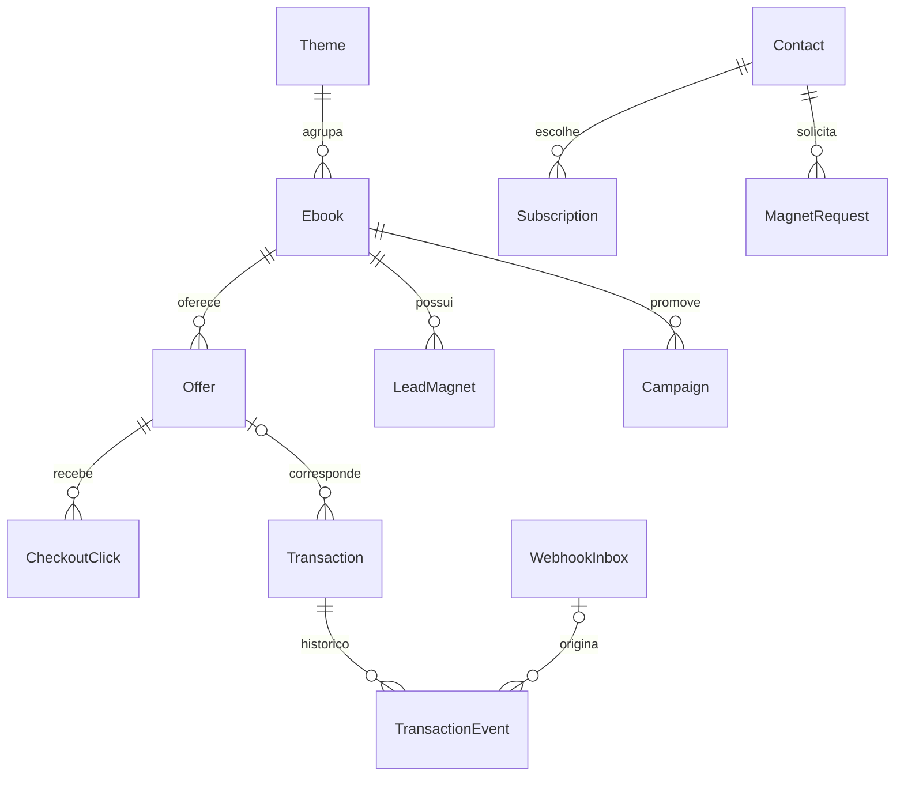

# 05 — Modelo de dados e invariantes

[Índice](../README.md) · [Interfaces](06-interfaces.md) · [Integrações](07-integracoes.md)

## Convenções

IDs internos UUID; datas em UTC, apresentação America/Belem. Valores monetários em centavos inteiros com moeda ISO (`BRL` inicialmente). Quantia desconhecida é `null`, nunca zero. Strings externas são opacas, sem conversão numérica. Todas as entidades têm createdAt/updatedAt. Slugs minúsculos ASCII com hífens, únicos no tipo.

Modelo lógico de referência. Parte já está mapeada em coleções e migrações; estado e evidências em [desenvolvimento](19-desenvolvimento.md). Relações e índices devem existir no banco, não depender só do formulário.

Na revisão de 21/10/2026 existem coleções editoriais, Campaign, Redirects, SiteSettings, contatos/consentimento, pedidos/outbox, tokens, limites/quota, EmailSequence, SequenceEnrollment e PromotionDelivery. EmailCampaignBatch, MarketingTask, Visit/CheckoutClick, Transaction/Event, WebhookInbox, ImportBatch/Row, CostEntry e AuditEvent genérico permanecem modelo previsto, não tabelas implementadas. A trilha de consentimento/supressão existente não substitui auditoria financeira. Ver [mapa vigente](23-estado-atual.md).

| Entidade | Campos principais e restrições |
|---|---|
| AdminUser | email único, autenticação Payload, papel único `owner`; sem inscrição pública |
| Theme | slug, nome, introdução, estado editorial |
| Ebook | slug, título, resumo, themeId, público, problema, promessa, benefícios, sumário, requisitos, limites, coverId, blocos LP, materialState (`production/ready`), estado editorial |
| Media | nome interno, MIME real, tamanho, hash, finalidade, visibilidade (`public/private`), alt; nenhum livro pago completo |
| LeadMagnet | ebookId, mediaId, título, versão, ativo; material gratuito privado entregue por link temporário |
| Article | slug, título, resumo, corpo, themeId, ebookId opcional, autor exibido, estado editorial, SEO |
| Offer | ebookId, provider, accountKey, externalProductId, externalOfferId opcional, checkoutUrl, priceCents, currency, active, primary, lastVerifiedAt, eligibilityNote |
| Campaign | código único, ebookId, offerId, público, hipótese, canal, UTMs, tipo (`owned/affiliate`), affiliateUrl opcional, estado (`draft/active/paused/closed`), datas |
| MarketingTask | campaignId, descrição, prazo, estado (`todo/doing/done`), evidenceUrl opcional |
| Contact | email normalizado único, confirmedAt opcional, globalSuppressedAt, estado de entrega (`ok/bounced/complaint`); sem CPF/telefone |
| Subscription | contactId + themeId únicos, estado (`pending/subscribed/unsubscribed`), consentVersion, timestamps |
| ConsentEvent | contactId, themeId opcional, finalidade, ação, versão do texto e instante; trilha append-only |
| MagnetRequest | contactId, magnetId, confirmationTokenHash, expiresAt, confirmedAt, deliveredAt; solicitação não implica marketing |
| EmailSequence | amostra/versão únicas, revisão inteira crescente, oferta, quatro assuntos/textos manuais, ativo e hash do conteúdo; ativação exige cópia completa e vínculos coerentes |
| SequenceEnrollment | contato/material/versão únicos, pedido, tema, sequência, confirmedAt, snapshot de revisão/conteúdo/oferta/campanha e estado; nova solicitação não reinicia sequência anterior |
| PromotionDelivery | inscrição/etapa únicas, D+2/4/7/10, dueAt fixo, nextCheckAt, estado e motivo; coleção privada, pronta indica elegibilidade local para agrupamento |
| EmailCampaignBatch | tema/etapa/data, chave única, providerCampaignId, destinatários elegíveis, estado e timestamps; marketing via API de campanhas |
| EmailDelivery | chave única de pedido/etapa, contactId, providerMessageId opcional, estado, attempts, nextAttemptAt; sem corpo de mensagem nos logs |
| PreferenceToken | contactId, tokenHash único, expiresAt; finalidade de cancelamento global de marketing, 180 dias, sem token bruto persistido |
| MailQuota / RequestLimit | Quota compartilhada reservada por destinatário/dia UTC; promoções preservam capacidade transacional. Limites globais/por endereço com chave pseudonimizada e expiração de até 24h |
| Visit | id aleatório consentido, início/fim, campanha e UTMs sanitizadas; sem identidade do comprador |
| CheckoutClick | id aleatório, offerId, campaignId opcional, visitId opcional, instante, attributionAllowed; sem e-mail |
| Transaction | provider + accountKey + externalTransactionId únicos; offerId opcional, externalProductId, estado, valores, moeda, providerUpdatedAt, approvedAt, attributionClickId opcional, evidenceSource |
| TransactionEvent | transactionId, tipo normalizado, occurredAt, valor parcial se aplicável, inboxId/importRowId; histórico imutável |
| WebhookInbox | provider, accountKey, eventKey único nesse escopo, envelope mínimo validado, hash, receivedAt, status, attempts, erro sanitizado, adapterVersion |
| ImportBatch / ImportRow | autor, hash de arquivo, linhas normalizadas, prévia, status, contagens, justificativa; CSV original descartado após processamento |
| CostEntry | período, campaignId opcional, categoria, amountCents, currency, fonte, confirmado/estimado |
| AuditEvent | ator, ação, entidade/id, horário, resumo sem segredos/PII |

## Relações

## Estados e regras

Editorial: `draft → published → archived`; editar um publicado mantém revisão anterior pública até nova publicação. Uma versão em produção não pode habilitar compra. Preview autenticado pode mostrar pendências.

Oferta: publicação de CTA exige livro ready, URL revisada, preço e IDs externos. No máximo uma oferta primária ativa por livro (índice parcial e validação transacional). Desativar primária deixa compra principal indisponível até escolha explícita; não fazer rodízio automático. Moedas não suportadas não são convertidas implicitamente.

Transação: `pending`, `approved`, `refused`, `canceled`, `partially_refunded`, `refunded`, `chargeback`, `unknown`. Compra aprovada só nasce de evento autenticado mapeado ou relatório reconciliado. Cliques e abandonos não criam receita. Eventos de assinatura não anulam uma compra avulsa.

Manter valores aprovados e devolvidos separados. Valor parcial não informado não é inferido. Chargeback é estado financeiro separado e não soma uma segunda devolução por padrão. Timestamp ausente, conflito de valores ou sequência ambígua resulta em `needs_review` na inbox, preservando a transação conhecida.

Eventos anteriores ao estado conhecido entram no histórico sem regredir projeção. Reembolso recebido antes da aprovação mantém projeção de reembolso; aprovação antiga posterior não reabre receita. Mesmo timestamp com estados conflitantes exige conciliação. Identidade externa desconhecida fica em quarentena sem inventar associação ao livro.

## Índices e exclusão

Índices: slugs; provider/account/transaction; provider/account/eventKey; offer/occurredAt; campaign/occurredAt; inbox status/nextAttemptAt; subscriptions contact/theme; jobs due/status. Search simples no texto normalizado.

Livro/oferta com histórico são arquivados, não apagados em cascata. Contato pode ser excluído ou anonimizado conforme política; transação mínima não deve depender de FK para contato. IDs pseudônimos ainda exigem proteção e retenção. Ver [política](12-seguranca-privacidade.md).

## Extensão de apresentação

Campos lógicos adicionais do Ebook: `presentationVariant: guide | reading | workbook` (default guide) e `accentPreset: mineral | slate | plum` (default mineral). Validação no servidor por allowlist. `workbook` exige amostra de exercício real referenciada; capas e sumário continuam campos existentes. Ausência de campo em registros anteriores usa defaults; migração futura aditiva. Tema de assunto (`Theme`) não se confunde com aparência clara/escura.

Media acrescenta `width` e `height` extraídos do arquivo, `caption` editorial opcional, `presentationRole: cover | sample | contextual` e `focalPoint: {x,y}` opcional, normalizado 0–1, exclusivo de contextual. Alt existente continua obrigatório quando informativo. Capas e amostras preservam proporção, usam contain e ignoram crop; aplicação deve impedir ponto focal em papéis incompatíveis. Default para legado: papel segundo finalidade existente; desconhecido exige revisão antes de publicação.

A preferência `system | light | dark` não pertence ao livro nem ao comprador: fica em `bibliotheon:appearance:v1` no navegador. Não criar endpoint de perfil, tabela de aparência ou identificador de visitante para esse fim. Dados monetários, afiliados, transações e consentimento permanecem com seus contratos atuais.
