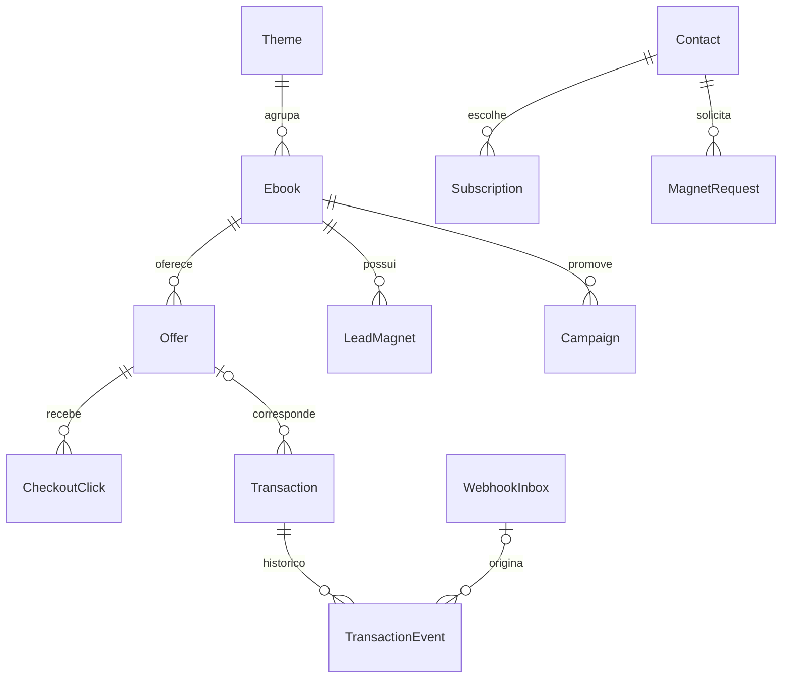

# 05 — Modelo de dados e invariantes

[Índice](../README.md) · [Interfaces](06-interfaces.md) · [Integrações](07-integracoes.md)

## Convenções

IDs internos UUID; datas em UTC, apresentação America/Belem. Valores monetários em centavos inteiros com moeda ISO (`BRL` inicialmente). Quantia desconhecida é `null`, nunca zero. Strings externas são opacas, sem conversão numérica. Todas as entidades têm createdAt/updatedAt. Slugs minúsculos ASCII com hífens, únicos no tipo.

Modelo lógico de referência. Parte já está mapeada em coleções e migrações; estado e evidências em [desenvolvimento](19-desenvolvimento.md). Relações e índices devem existir no banco, não depender só do formulário.

Na revisão documental de 28/10/2026, o histórico de implementação inclui coleções editoriais, Campaign, Redirects, SiteSettings, contatos/consentimento, pedidos/outbox, tokens, limites/quota, EmailSequence, SequenceEnrollment, PromotionDelivery e, desde 22/10, EmailCampaignBatch, BrevoSuppression, BrevoRegistration e BrevoBatchList locais. Visit/PageView/CheckoutClick e permissões foram acrescentados em D59. D61 acrescenta commercial-inbox, commercial-conflicts, transactions, transaction-events e commercial-audit. D67 acrescenta commercial-import-batches/rows/audit locais. D72 acrescenta catalog-resolutions e referência opcional catalogResolution nos novos fatos; D74 cria financial-resolutions/applications; D75 cria commercial-report-evidence; D77 estende lotes com kind=report_evidence; D78 acrescenta commercial-settlement-evidence e financial-cost-entries imutáveis. D79–D81 usam essas coleções sem novo schema. D81 mapeia explicitamente campaignId do contrato de custo ao relacionamento campaign da coleção. MarketingTask e AuditEvent genérico permanecem previstos. A trilha de consentimento/supressão existente não substitui auditoria financeira. Ver [mapa vigente](23-estado-atual.md).

Schema atual: **35 migrations**, conferidas em vazio/upgrade 32→35 na imagem D127. A auditoria P07 D128 inventaria 43 coleções operacionais; 12 comerciais não têm retenção geral. Não confundir esse inventário com todas as coleções editoriais do CMS ou com expurgo concluído. Ver [lacunas de privacidade](25-fechamento-producao.md).

| Entidade | Campos principais e restrições |
|---|---|
| AdminUser | email único, autenticação Payload, papel único `owner`; sem inscrição pública |
| Theme | slug, nome, introdução, estado editorial |
| Ebook | slug, título, resumo, themeId, público, problema, promessa, benefícios, sumário, requisitos, limites, coverId, blocos LP, materialState (`production/ready`), estado editorial |
| Media | nome interno, MIME real, tamanho, hash, finalidade, visibilidade (`public/private`), alt; nenhum livro pago completo |
| LeadMagnet | ebookId, mediaId, título, versão, ativo; material gratuito privado entregue por link temporário |
| Article | slug, título, resumo, corpo, themeId, ebookId opcional, autor exibido, estado editorial, SEO |
| Offer | ebookId, provider, accountKey, externalProductId, externalOfferId opcional, checkoutUrl, priceCents, currency, active, primary, lastVerifiedAt, eligibilityNote |
| Campaign | código único, ebookId, offerId, público, hipótese, canal, UTMs, tipo (`owned/affiliate`), affiliateUrl opcional, estado (`draft/active/paused/closed`), datas |
| MarketingTask | campaignId, descrição, prazo, estado (`todo/doing/done`), evidenceUrl opcional |
| Contact | email normalizado único, confirmedAt opcional, globalSuppressedAt, estado de entrega (`ok/bounced/complaint`); sem CPF/telefone |
| Subscription | contactId + themeId únicos, estado (`pending/subscribed/unsubscribed`), consentVersion, timestamps |
| ConsentEvent | contactId, themeId opcional, finalidade, ação, versão do texto e instante; trilha append-only |
| MagnetRequest | contactId, magnetId, confirmationTokenHash, expiresAt, confirmedAt, deliveredAt; solicitação não implica marketing. D92: solicitações não confirmadas com mais de sete dias entram no cleanup transacional com o outbox pendente |
| EmailSequence | amostra/versão únicas, revisão inteira crescente, oferta, quatro assuntos/textos manuais, ativo e hash do conteúdo; ativação exige cópia completa e vínculos coerentes |
| SequenceEnrollment | contato/material/versão únicos, pedido, tema, sequência, confirmedAt, snapshot de revisão/conteúdo/oferta/campanha e estado; nova solicitação não reinicia sequência anterior |
| PromotionDelivery | inscrição/etapa únicas, D+2/4/7/10, dueAt fixo, nextCheckAt, estado e motivo; coleção privada, pronta indica elegibilidade local para agrupamento; referência opcional ao lote |
| EmailCampaignBatch | Implementado localmente: tema/etapa/dia previsto UTC, chave única, cópia revisada, referências de contatos/etapas e contagem de destinatários únicos, estado/timestamps e providerCheck pontual, vinculada a chave/versões locais e IDs de contatos do provedor. IDs/sincronização de listas e rascunhos/campanhas, transporte/observação e callback locais D52–D58; conta não homologada |
| BrevoSuppression | fila privada única por contato, revisão, estado pending/processing/synced/failed, tentativas, lease, próxima conferência, resultado blocked/absent e códigos genéricos; sem endereço/payload/token na fila |
| BrevoRegistration | fila privada única por contato, revisão/lease/tentativas, estado pending/processing/synced/failed/canceled/canceling, versão local e ID no provedor; sem endereço/payload/token na fila |
| BrevoBatchList | manifesto privado único por lote, nome/pasta, conjunto imutável, ID externo único, lease, criação emitida, inclusões tentadas e conferência recente; sem endereços/payloads |
| EmailDelivery | chave única de pedido/etapa, contactId, providerMessageId opcional, estado, attempts, nextAttemptAt; sem corpo de mensagem nos logs |
| PreferenceToken | contactId, tokenHash único, expiresAt; finalidade de cancelamento global de marketing, 180 dias, sem token bruto persistido |
| MailQuota / RequestLimit | Quota compartilhada reservada por destinatário/dia UTC; promoções preservam capacidade transacional. Limites globais/por endereço com chave pseudonimizada e expiração de até 24h |
| Visit | id aleatório consentido, início/fim, campanha e UTMs sanitizadas; sem identidade do comprador |
| CheckoutClick | id aleatório, offerId, campaignId opcional, visitId opcional, instante, attributionAllowed; sem e-mail |
| AnalyticsDailyAggregate | dia UTC, tipo de evento, livro/campanha/provedor/caminho público opcionais, contagem e chave técnica; sem grant, sessão ou UUID de clique. D89 agrega eventos analíticos que ultrapassaram 90 dias antes da exclusão |
| Transaction | provider + accountKey + externalTransactionId únicos; offerId opcional, externalProductId, estado, valores, moeda, providerUpdatedAt, approvedAt, attributionClickId opcional, evidenceSource |
| TransactionEvent | transactionId, tipo normalizado, occurredAt, valor parcial se aplicável, inboxId/importRowId; histórico imutável |
| WebhookInbox | provider, accountKey, eventKey único nesse escopo, envelope mínimo validado, hash, receivedAt, status, attempts, erro sanitizado, adapterVersion |
| ImportBatch / ImportRow | autor, hash de arquivo, linhas normalizadas, prévia, status, contagens, justificativa; CSV original descartado após processamento |
| CatalogResolution | provedor/conta/produto/oferta, revisão/previous, ação associate/hold, alvo conferido por oferta ou livro, autor/fonte/justificativa, planHash/snapshot e chave idempotente; trilha imutável D72 |
| CommercialSettlementEvidence | provedor/conta/transação, crédito ou débito, amountCents/currency, referência de liquidação/fonte/linha, substituição, autoria e timestamps; imutável |
| FinancialCostEntry | categoria, amountCents/currency, campaign opcional, confirmado/estimado, fonte/linha, substituição, autoria e timestamps; imutável |
| AuditEvent | ator, ação, entidade/id, horário, resumo sem segredos/PII |

## Relações

## Estados e regras

Editorial: `draft → published → archived`; editar um publicado mantém revisão anterior pública até nova publicação. Uma versão em produção não pode habilitar compra. Preview autenticado pode mostrar pendências.

Oferta: publicação de CTA exige livro ready, URL revisada, preço e IDs externos. No máximo uma oferta primária ativa por livro (índice parcial e validação transacional). Desativar primária deixa compra principal indisponível até escolha explícita; não fazer rodízio automático. Moedas não suportadas não são convertidas implicitamente.

Transação: `pending`, `approved`, `refused`, `canceled`, `partially_refunded`, `refunded`, `chargeback`, `unknown`. Compra aprovada só nasce de evento autenticado mapeado ou relatório reconciliado. Cliques e abandonos não criam receita. Eventos de assinatura não anulam uma compra avulsa.

Manter valores aprovados e devolvidos separados. Valor parcial não informado não é inferido. Chargeback é estado financeiro separado e não soma uma segunda devolução por padrão. Timestamp ausente, conflito de valores ou sequência ambígua resulta em `needs_review` na inbox, preservando a transação conhecida.

Eventos anteriores ao estado conhecido entram no histórico sem regredir projeção. Reembolso recebido antes da aprovação mantém projeção de reembolso; aprovação antiga posterior não reabre receita. Mesmo timestamp com estados conflitantes exige conciliação. Identidade externa desconhecida fica em quarentena sem inventar associação ao livro.

## Índices e exclusão

Índices: slugs; provider/account/transaction; provider/account/eventKey; offer/occurredAt; campaign/occurredAt; inbox status/nextAttemptAt; subscriptions contact/theme; jobs due/status. Search simples no texto normalizado.

Livro/oferta com histórico são arquivados, não apagados em cascata. Contato pode ser excluído ou anonimizado conforme política; transação mínima não deve depender de FK para contato. IDs pseudônimos ainda exigem proteção e retenção. Ver [política](12-seguranca-privacidade.md).

## Extensão de apresentação

Campos lógicos adicionais do Ebook: `presentationVariant: guide | reading | workbook` (default guide) e `accentPreset: mineral | slate | plum` (default mineral). Validação no servidor por allowlist. `workbook` exige amostra de exercício real referenciada; capas e sumário continuam campos existentes. Ausência de campo em registros anteriores usa defaults; migração futura aditiva. Tema de assunto (`Theme`) não se confunde com aparência clara/escura.

Media acrescenta `width` e `height` extraídos do arquivo, `caption` editorial opcional, `presentationRole: cover | sample | contextual` e `focalPoint: {x,y}` opcional, normalizado 0–1, exclusivo de contextual. Alt existente continua obrigatório quando informativo. Capas e amostras preservam proporção, usam contain e ignoram crop; aplicação deve impedir ponto focal em papéis incompatíveis. Default para legado: papel segundo finalidade existente; desconhecido exige revisão antes de publicação.

A preferência `system | light | dark` não pertence ao livro nem ao comprador: fica em `bibliotheon:appearance:v1` no navegador. Não criar endpoint de perfil, tabela de aparência ou identificador de visitante para esse fim. Dados monetários, afiliados, transações e consentimento permanecem com seus contratos atuais.

## Lotes locais (D48)

Preparação limitada a 200 etapas por passagem, sob lock comum de montagem, com locks de contato em ordem. Agrupa tema, etapa, dia previsto UTC e snapshot integral da cópia (revisão, mensagens, livro, oferta e contexto de campanha). Várias etapas do mesmo destinatário dentro do lote preservam suas referências, mas contam uma vez para quota. Snapshot não contém e-mail nem token. Identidade do lote inclui o ID gerado pelo CMS, permitindo reagrupamento posterior sem colidir com lote cancelado.

Estados implementados: prepared (conjunto persistido), claimed (intenção reservada com quota), canceled e uncertain (retenção conservadora prevista para integração). Somente prepared pode ser tomado; resultado incerto não deve ser reciclado automaticamente. O claim interno revalida consentimento/material/versão/pausa e oferta comercial, usa a quota na mesma transação e muda as etapas para sending. O worker opcional D56 usa a reserva antes do POST; nenhum desses estados comprova entrega individual. Membros inelegíveis cancelam o lote inteiro sem quota e liberam vínculos para nova preparação; histórico permanece. IDs de lista/campanha e observação de atividade foram acrescentados em D52/D55–D57, descritos adiante.

## Sincronização de bloqueios (D49)

O descadastro global e a supressão revisada persistem intenção junto da mudança local; configuração desligada não impede a fila. Uma revisão nova durante processamento não é consumida pela resposta antiga. Claim é confirmado antes do HTTP, com lease de 30 minutos; chamadas fora da transação. Retentativa de bloqueio é segura porque não envia mensagem nem reativa contatos. Timeout/429/5xx/resposta inválida mantêm pendência com backoff de 1 minuto até 6 horas; recusa definitiva fica failed até retry explícito após correção. Processamento antigo não sobrescreve lease novo.

synced com outcome blocked significa bloqueio de marketing observado naquele instante; absent significa 404 observado, sem criar contato. Não prova entrega, bloqueio transacional nem preservação futura contra alterações externas. Não se envia emailBlacklisted=false ou atributo EMAIL. Nova inscrição local não limpa o bloqueio no provedor automaticamente; revisar elegibilidade antes de futuras campanhas. A nona migração enfileira bloqueios históricos locais. Exclusão/retorno de dados após restore continuam na B12.

## Conferência pontual de destinatários (D50)

providerCheck na coleção de lotes guarda somente versão do formato, chave do lote, checkedAt e referências de contato/versão local/providerId; não copia e-mail, token, atributos ou estatísticas. Validade de até cinco minutos desde o início das consultas, conservadora para o destinatário mais antigo. Destinatários e IDs do provedor devem ser únicos e corresponder ao conjunto atual; alteração do lote/contato, data futura ou expirada invalidam a prova. Claim interno executa o preflight obrigatoriamente, revisa tudo sob locks e só então reserva quota.

Bloqueio observado em GET autenticado produz ConsentEvent.action=provider_blocked por referência HMAC, independente das ações manuais e sem supor o motivo da blacklist. A identidade local deve continuar correspondendo ao endereço consultado; não cria contato a partir dessa observação. Importação, cancelamento e intenção outbound são atômicos. Contato ausente/falha/recusa mantém lote prepared, sem prova, com motivo e nova conferência em 15 minutos. Preflight não cria contato, lista/campanha nem envia. A observação pontual não substitui callback D58 e revalidação do transporte D56, implementados localmente sem homologação externa.

## Cadastro consentido no provedor (D51)

A confirmação com opt-in e assinatura temática ativa enfileira cadastro no mesmo commit; amostra isolada não enfileira. Backfill da migração seleciona somente confirmados, sem bloqueio e com assinatura ativa. O processamento captura identidade/versão e revalida consentimento, grava claim antes do HTTP e reconcilia por GET. POST contém apenas email/updateEnabled=false/forceMerge=false, sem listas/atributos, troca de identidade ou desbloqueio. Resultado synced significa contato observado e elegibilidade local conferida, não campanha/entrega. Nova confirmação em voo aumenta revisão e exige nova conferência.

Descadastro antes de tentativa cancela sem criar. Havendo tentativa incerta, canceling preserva compensação: ausência observada não prova que um POST anterior nunca será aplicado. Reconsulta/bloqueio com backoff até seis horas, inclusive por worker só de bloqueios, até observar bloqueio; não faz POST nessa fase. Depois de contato já observado/resultado resolvido, intenção de bloqueio permanece durável. API pública não permite trocar identidade de contatos; alteração indevida interrompe como identity_changed e exige intervenção. Retentativa não apaga histórico de tentativas; downgrade recusa perder tentativas/IDs/compensações.

## Listas exclusivas de lote (D52)

Estados creating/filling/ready/uncertain/failed/canceled. Nome opaco bibliotheon-UUID do lote e pasta dedicada conferida pelo operador. Snapshot contém referências e IDs de contatos já conferidos; não copia email/atributos. Intento de criação e cada bloco de até 150 IDs são commitados antes do HTTP. ID retornado é retido imediatamente, inclusive se metadados falharem ou consentimento tiver sido retirado; isso não autoriza composição.

Criação incerta busca por nome exato na pasta, com paginação e recusa de duplicidade; 404 não autoriza repetir POST depois de emitida a intenção. ID explícito do operador exige metadados correspondentes. Só criação explicitamente recusada sem ID pode ter retry de criação, mediante opção privada; recusa permanece registrada até essa intervenção. Inclusão parcial/incerta é reconferida por GET; ID já tentado e ainda ausente não é reincluído automaticamente, evitando apagar preferência de lista. Destinatários extras, blacklist ou descadastro na lista interrompem sem remoção arbitrária; campos opcionais ausentes ficam não conferidos.

ready indica composição observada, com mesmo conjunto e metadados, seguida de nova revisão local/preflight. A conferência de membros e a de contatos têm validade própria de até cinco minutos; preflight novo não renova uma composição antiga. Não significa campanha/aceitação/entrega. Listas canceladas ou órfãs permanecem identificadas no manifesto para revisão/retenção B12; nenhuma lista externa é apagada automaticamente.

### Preferências temáticas — D53

Usa PreferenceTokens, Subscription e ConsentEvent existentes; sem nova migração. POST de consulta só projeta ID/nome dos temas já assinados pelo titular do token; não devolve endereço ou dados de outro contato. Retirada grava estado unsubscribed/unsubscribedAt e evento marketing/unsubscribed com theme, no mesmo commit do cancelamento das inscrições e etapas daquele assunto. Se não restar assinatura ativa, cancela cadastro Brevo e enfileira bloqueio externo. Não remove amostras/pedidos nem reativa temas ou contatos. Global continua em fluxo separado.

### Links individuais no provedor — D54

PreferenceToken recebe sourceKey única/opcional por contato e nonce opcional; tokens transacionais antigos continuam intactos. HMAC de finalidade própria permite reconstruir token em memória, com hash único para autorização pública existente. Rotação limpa somente sourceKey anterior; preserva hash/expiração, cria novo nonce e nunca estende a validade do registro antigo. URL/token bruto não pertencem a JSON de lote, auditoria, logs ou artifacts.

EmailCampaignBatch.preferenceCheck contém version, batchKey, checkedAt e referências contact/version/providerId/tokenId/expiresAt. Só é concluído após GET observar atributo correto para cada contato e revisão local final; TTL próprio de cinco minutos e correspondência com o preflight atual. Falha limpa prova, atraso usa nextAttemptAt e cancelamento limpa providerCheck/preferenceCheck. Sem nova tabela, quota ou estado de envio.

### Rascunho de campanha Brevo — D55

BrevoCampaignDraft possui relação única com lote, name opaco, content (cópia de assunto/HTML/lista/remetente), contentHash, providerCampaignId único opcional, observedIds, state, leaseToken, startedAt, creationIssuedAt, nextAttemptAt, verifiedAt e errorCode. Estados creating/ready/uncertain/failed/canceled; coleção somente leitura do owner via API, mutações só pelo fluxo privado. Não contém emails/tokens de destinatários nem estatísticas recebidas.

ID conhecido é retido antes de GET, inclusive após descadastro; IDs conflitantes são inventariados sem violar unicidade de associação entre lotes. Descadastro ou prova expirada impede ready. Retomada de criação incerta não reenvia POST, mesmo após ausência; somente rejeição explícita sem ID permite retry privado. Rascunhos órfãos permanecem para inventário/retenção B12. 14a migração recusa downgrade que perderia intenção/IDs.

### Tentativas de disparo — D56

BrevoCampaignSend liga-se exclusivamente a lote/rascunho/campanha. Guarda batchKey, contentHash, recipientCount, attempts, attemptToken, history, state, leaseToken, prepareStartedAt, nextAttemptAt, issuedAt, settledAt, retryRequestedAt, responseCode e errorCode. Estados preparing/issuing/submitted/rejected/uncertain/canceled. Campos de rascunho/ID/intenção ficam opcionais em preparing e obrigatórios por constraint na emissão/resultados; histórico mínimo por tentativa sem emails/tokens de preferência/corpos externos.

Intenção de emissão e quota atômicas. Retorno conhecido atualiza solicitação, lote e etapas no mesmo commit: submitted mantém lote claimed e etapas accepted; rejected aparece no lote/etapas; uncertain preserva reserva e bloqueia reenvio. Rejeição documentada só pode retornar à preparação por ação explícita, com revalidação; descadastro cancela também etapas rejected e não restaura inscrição. Cada nova tentativa conta outra reserva diária, sem devolução automática das anteriores.

15a migração aditiva amplia enums e adiciona coleção. Downgrade só sem tentativas/estados novos; remove/recria o índice parcial de etapas na troca do enum, preservando acesso por data. Não apagar histórico para forçar rollback ou novo envio.

## Observação de campanha — D57

BrevoCampaignObservations é privada, única por send, com attemptToken/lease, estado pending/processing/matched/conflict/failed, próxima consulta e timestamps separados de checagem/atividade/envio observado/data informada pelo provedor. lastStatus preserva o enum nativo; activityStatus guarda apenas atividade positiva. Estatísticas e payload bruto não são persistidos. O manifesto original permanece a referência de identidade mesmo se o catálogo for editado.

BrevoCampaignSends e PromotionDeliveries acrescentam observed, sem mudar o histórico HTTP. Lote permanece claimed e quota reservada; etapas canceladas não são reativadas. Estado observado não comprova entrega individual. Fila nasce no commit de emissão e possui backfill aditivo na migração 16. Consulta não altera inscrição, consentimento ou destinatários. Ver D57 em [decisões](17-decisoes.md).

## Inbox Brevo e resultados individuais — D58

BrevoWebhookEvents: chave semântica e impressão HMAC de destinatário, contato previamente existente opcional, evento nativo, ID de campanha/webhook, datas UTC de ocorrência/envio/recepção/processamento, estado pending/processed/quarantined, motivo, indicador de supressão aplicada e etapa correlacionada opcional. Sem email duplicado, payload bruto ou links. Desconhecido não cria contato nem é associado automaticamente a um futuro cadastro.

BrevoDeliveryReceipts: único por promotion-delivery, relacionado ao send, campanha e impressão de identidade; firstObservedAt, deliveredAt, hardBouncedAt, softBouncedAt, spamAt e unsubscribedAt preservados separadamente, escolhendo a primeira data de cada ocorrência. Não existe projeção de venda ou receita a partir dessas datas. Inbox/resultados e efeitos locais são atômicos; replay não aplica supressão novamente.

BrevoCampaignSends.recipientIdentities guarda somente versão e conjunto ordenado de contato/etapa/impressão HMAC capturados antes de POST. Legado sem prova não recebe backfill baseado no cadastro atual. Chave de links e segredo de deduplicação devem ser recuperados junto da configuração privada; rotação requer plano para históricos, não simples substituição. Migrações 17/18 aditivas, com downgrade guardado; ver [D58](17-decisoes.md).

## Medição própria — D59

AnalyticsGrant guarda hash de token/versão/datas de permissão e revogação, sessão atual e first-touch/último toque não direto na janela de 30 dias. Visit é sessão consentida de 30 minutos inativa, sem identidade do comprador. PageView tem chave de idempotência por permissão/UUID, sessão, caminho público sem query, referência opcional de livro/campanha e UTMs controladas. CheckoutClick tem oferta/livro/plataforma/campanha e data; sessão e contexto só existem se attributionAllowed. Campo booleano não prova vínculo de compra. AnalyticsLimit limita emissões/eventos sem capturar IP. Não são Transaction/TransactionEvent nem inbox comercial.

Datas e integridade de atribuição têm constraints/índices na migração 19. Campaign acrescenta utmTerm e valida códigos UTM; componente de link usa somente registros salvos e destinos comerciais conferidos. Excluir oferta/livro com saídas históricas continua exigindo preservação/arquivamento; não apagar provas em cascata. Retenção/exclusão/restore de medição são B12, ainda pendentes. Ver [D59](17-decisoes.md).

## Histórico comercial persistido — D61

Migração 20 cria cinco coleções privadas. commercial-inbox conserva chave única por provider/account/event, envelope mínimo, hash, versão do adaptador, chave da transação, datas, estado, lease, erro e contador cumulativo. attemptBase marca o início do orçamento automático atual sem apagar attempts. commercial-conflicts conserva o segundo envelope divergente uma única vez por impressão; o original não é trocado.

transactions é projeção por provider/account/externalTransactionId, ligada a livro por catálogo exato e a oferta somente quando a identidade é explícita. Guarda moeda, valores conhecidos, último sucesso e revisão. transaction-events conserva cada fato normalizado único e sua origem, inclusive divergências que impediram atualizar a projeção; outcome registra o resultado daquela aplicação, não reescreve retrospectivamente o fato. commercial-audit registra recebimento, ignorado, conflito, aplicação, revisão, falha e retry, com data/ator/motivo controlado. Não guarda corpo original, e-mail, credenciais ou justificativa livre.

Há índices de unicidade/fila/identidade e checks SQL de centavos seguros, orçamento e lease. Valores ausentes permanecem null; aprovação não gera liquidação. Mudanças de identidade de oferta com histórico da mesma conta/produto são recusadas; criar outra oferta preserva a referência histórica. Downgrade recusa qualquer registro nas cinco tabelas. Atribuição a clique, liquidação, CSV e custos ainda não existem.

## Evidência nativa mínima Hotmart — D63

Envelope pode preservar sourceEvent, sourceCreatedAt e approvedAt explícito. As duas datas não se confundem: aprovação financeira original versus criação da notificação. Null de aprovação é desconhecido; ausência em envelopes legados preserva interpretação/hash anteriores. ReviewReason só aceita enum controlado; precisão de moeda/forma de compra/estado sem suporte não vira aprovação automática. Tudo permanece no JSON existente, sem nova migração ou corpo integral.

A projeção protege também cancelamento regressivo após aprovação, inclusive quando a aprovação conhecida ainda não tinha data. Divergência entre datas explícitas mantém a última projeção em revisão, sem reescrever fatos antigos. Nenhum backfill por data de recebimento, endereço, valor ou aproximação.

## Evidência Kiwify — D64

Sem nova tabela/migração. Envelope comercial JSON inclui sourceEvent, sourceCreatedAt (criação do pedido), approvedAt explícito/null e motivo controlado unknown_event_time. occurredAt pode ser criação como âncora de envelope em revisão, nunca prova de chargeback/recusa: revisão impede aplicação. approvedAt não é inferido de updated_at/criação. Valores Kiwify já são inteiros em centavos; taxa em outra moeda, líquido, recebido, atribuição e devolução monetária permanecem desconhecidos. PII, campos de pagamento/acesso e assinatura da URL não entram na inbox. Ver [contrato](integracoes/kiwify.md).

## Cakto V1/V2 — D65

Cada pedido nativo possui um recibo/fato próprio, inclusive em lista da mesma cobrança. Identidade interna combina data.id + event e namespace de provedor/conta; não usar refId, índice ou instante de envio. sourceCreatedAt é criação do pedido, approvedAt preserva paidAt. amount/fees são decimais convertidos exatamente; net/settled/reversões monetárias e atribuição seguem desconhecidos. Campos de pagamento, comprador, acesso, comissões, callback e secret são descartados.

O motivo controlado dispute_not_final no JSON mantém MED/pré-chargeback em revisão. Recusa sem instante e datas insuficientes usam unknown_event_time. Sem novas colunas/migração. Datas ISO nativas têm precisão normalizada a milissegundos sem arredondamento; conflitos simultâneos permanecem em revisão. Abandonos são ignorados/agrupados sem identificar comprador, e não constituem analytics de abandono. [Contrato](integracoes/cakto.md).

## Prévia de instantâneos CSV — D66

Prévia canônica interpreta as treze colunas documentadas e compara com catálogo/projeção, sem criar ImportBatch/ImportRow, fato, transação, auditoria ou arquivo Media. FileHash e linhas normalizadas só na resposta owner; dados inválidos retornam número/código sem conteúdo. settled_cents informado exige revisão e não é projetado; zero/null distintos, sem inferir movimentos/somas. Registros distintos da mesma transação no lote conflitam, não são sequência de webhooks. [Contrato completo](24-conciliacao.md). Vinte migrações preservadas; persistência/auditoria de importação ainda pendentes.

## Lotes e linhas duráveis — D67

commercial-import-batches guarda hashes do pedido/arquivo/manifesto/plano, fonte/referência/justificativa controladas, actor, estado/counts/datas e confirmedBy. commercial-import-rows guarda linha lógica, chave/hash, snapshot normalizado, classificação/razão, duplicateOf, estado e referências a inbox/transação. commercial-import-audit é trilha privada de estágio/confirmação/repetição/stale com owner/data/motivo. CSV bruto e linha inválida não persistem. Migração 21 tem unicidade batch/line, checks de hashes/contagem/linha e recusa down com qualquer evidência.

Fonte nova csv-owner-snapshot-v1 não se passa por autenticação do fornecedor. Fato mantém approvedAt declarado somente em approved, sem criação original inventada; outras aprovações ficam desconhecidas. Commit enfileira ou confirma compatibilidade, não escreve projeção/recebimento. [Estados, limites e custódia](24-conciliacao.md).

## D71 — Integridade SQL de identidades do catálogo — 24/10/2026

Migração 22, [offer_identity_guard](../migrations/20261024_231500_offer_identity_guard.ts), aplicada somente no PostgreSQL local. Trigger BEFORE INSERT/UPDATE/DELETE e índice por provedor/conta/produto reforçam o guard da API D70: impedem novas duplicatas (null/vazio equivalentes), associação do produto a outro livro e alteração/exclusão de identidade com transação histórica. Inclui ofertas inativas. Preserva registros legados e seus metadados; não escolhe livro/oferta automaticamente nem altera fatos.

[Evidência SQL local](../artifacts/catalog-identity-db/local-results.json): seis grupos, papel runtime efêmero sem DDL, concorrência observada em pg_locks, API versus SQL, commit/rollback, lote de INSERT revertido, isolamento de contas/provedores, compatibilidade das chaves de lock e upgrade sem alteração de registros legados. Comando: BIBLIOTHEON_SYNTHETIC_TESTS=true npm run test:catalog-identity-db; incluído no runner sequencial de CI preparado. Sem novo serviço/flag/coleção ou campos/tipos Payload. Produção e P01 continuam pendentes até a resolução histórica auditada e homologação do release.

## Associação original e efetiva — D72

A correção histórica não altera ebook/offer já registrados na transação nem o envelope de fatos antigos. Decisão vigente por identidade externa define a associação efetiva; novos fatos que a utilizam referenciam catalogResolution. Oferta ausente não vira uma oferta externa inventada. É possível corrigir diretamente o livro de um cadastro único errado, sem inserir outra oferta conflitante. Alvos por oferta precisam respeitar namespace e livro; alvo direto por livro exige conferência explícita. O catálogo público/checkout continua manual e sujeito aos seus guards.

Revisões são append-only, com unicidade escopo/revisão, continuidade de previous e conferência de escopo/alvo no banco. Update/delete da trilha são recusados; FKs preservam prova/alvos. Lotes CSV incluem decisões na revalidação; hold suspende associação, sem apagar valores conhecidos. Financeiro futuro deve distinguir referência original de associação efetiva. [Contrato](24-conciliacao.md).

## Quarentena e componente de colisão — D73

Variação de envelope pode nomear outra transação usando a mesma chave de evento. Todos os IDs diretamente citados têm suas projeções existentes sinalizadas para revisão, sem alterar valores conhecidos. Worker/retry/CSV consultam também externalTransactionId do envelope interno normalizado de commercial-conflicts. Índice funcional da migração 24 atende esse lookup; não é parser de layout nativo. Flags legadas são reparadas pela migração e não são limpas no down por suposição.

A prévia de decisão financeira expande o componente de recibos/variantes conectado por IDs; nada é persistido por ela. Cobertura exige uma seleção por recibo, e cada chave compartilhada só pode contribuir com uma variante. Um ID sem fonte selecionada permanece em revisão; exclusão não vira valor zero. Plano financeiro durável e aplicação das projeções efetivas são trabalho restante de P02. [Contrato](24-conciliacao.md).

## Decisões e aplicações financeiras — D74

Migração 25 cria financial-resolutions e financial-resolution-applications, imutáveis com restrições SQL e escrita nativa negada. Decisão contém cobertura, escolhas, fonte/motivo e owner; aplicações registram a projeção por versão de evidência, sem constituir novas vendas. Transações mantêm referências originais e campos effectiveProductId/effectiveEbook/effectiveOffer separados; financialResolution relaciona a projeção à decisão. Novo fato nativo elegível também referencia financialResolution. Decisão/aplicação/projeções são atômicas, com revisões anteriores explícitas e guard de referências do catálogo. [Contrato e limites](24-conciliacao.md).

## Evidência complementar — D75

commercial-report-evidence guarda fonte/linha canônicas normalizadas, identidade e hashes, autoria/data, referências de substituição e IDs relacionados derivados. Migração 26 protege imutabilidade e autoria, indexa associação de IDs por GIN e recusa downgrade com prova. Origem permanece report; aplicações D74 podem usar a fonte sem criar evento/recibo nativo. Referências relacionadas permitem revisar ID externo errado sem perder o ID original. Ausência de prova mantém revisão, e nova evidência invalida cobertura anterior antes do ACK. [Campos e regras](24-conciliacao.md).

## Importação CSV canônica de evidências — D77

Migração 27 adiciona `kind` a `commercial-import-batches` (`snapshot`/`report_evidence`) e `recorded` ao estado de `commercial-import-rows`. Para lotes `report_evidence`, `normalized` guarda somente a entrada canônica por linha; arquivo bruto não é persistido. Preview não cria registros. O commit registra evidências D75, estado das linhas, confirmação e auditoria na mesma transação. Dedupe/stale é revalidado sob lock de conta. O downgrade recusa enquanto existir lote/prova desse tipo. [Esquema CSV e contrato](24-conciliacao.md).

## Livro de liquidações e custos — D78

`commercial-settlement-evidence` guarda movimentos de caixa explicitamente atribuídos a uma transação aprovada e comprovada, com provedor/conta, moeda, referência de liquidação, linha da fonte e direção `credit`/`debit`. A atribuição é transcrita pelo owner e não deriva de bruto ou líquido informado. `financial-cost-entries` guarda custos separados por categoria, moeda, período, fonte e classificação `confirmed`/`estimated`; campanha pode ficar nula quando o custo for compartilhado ou sem atribuição. Correções são novos registros com `supersedes`; SQL bloqueia update/delete, e downgrade recusa dados persistidos. Ambas as coleções negam CRUD nativo.

O relatório é uma prévia somente leitura. Aprovações/coortes usam `approvedAt`; dinheiro recebido usa `settledAt`; custos usam `incurredAt`. Moedas não são convertidas. Ausência permanece null, com cobertura conhecida/total. Tributos não são modelados, portanto margem completa e lucro fiscal não são alegados.

D82 expõe catalog-resolutions na view owner: histórico de revisões append-only, anterior/sucessora do mesmo scopeKey e snapshot de conferência. Não altera schema nem referências originais; 28 migrations. Última revisão registrada não significa destino ainda válido: outra decisão requer revalidação.

D83 expõe financial-resolutions e financial-resolution-applications na interface owner sem schema novo: snapshot/choice/outcomes, autoria/fonte/atestação, previousIds e aplicações derivadas. Revisão é sequencial na conta, não necessariamente na transação isolada. Uma aplicação worker não é outra decisão ou venda. Valores monetários assinados são exibidos com sinal preservado, inclusive -1 centavo, sem ponto flutuante. São 28 migrations.

D84 não cria campos/migrations persistidos. Resposta calculada acrescenta observedAt, inReviewIncluded/inReviewMissingDateExcluded, transactionsInReviewWithEvidence, arithmeticOverflowFields e dados de coorte (verifiedTransactions, transactionsInReview, reversalCoverage/reversedTransactions/reversalRate e maturity). Quarentena, mesmo state=unknown, não compõe valores conhecidos; data ausente aparece em cobertura separada. São 28 migrations.

D85 acrescenta apenas resposta calculada dimensions: byProvider, byBook, byCampaign, attributionCoverage e processing. Metadados usam ebook/effectiveEbook e lastSuccessAt já persistidos; títulos de livro/códigos de campanha são rótulos atuais, sem editar históricos. Processing se refere às transações com aprovação na janela, incluindo sucesso histórico de quem hoje está em revisão; data ausente/inválida/futura não é substituída por consulta/evento. São 28 migrations.

D86 não muda modelo ou schema. Aceite verifica linhas normalizadas dos sete estados, prova persistida sem projeção, decisão que aplica estado/valores/datas e repetição sem duplicação. Provas insuficientes/incompatíveis podem permanecer como evidência, mas não geram transação por atestação; ausência continua null. Snapshot de 13 colunas conserva semântica distinta do CSV complementar de 18. Continuam 28 migrations.

## Pedidos de dados — D90–D94

Migration 30 cria `privacy-request-audit`: impressão HMAC do email como identificador pseudônimo, ação, resultado, contagens por coleção, owner e instante. Não contém endereço nem cópia da exportação. A rota exporta relações diretas e recibos ligados às etapas promocionais, com campos explicitamente selecionados e páginas de 500; hashes de confirmação/preferência, identificadores HMAC de destinatário, chaves e corpos de webhook não são incluídos. Os agregados analíticos não se relacionam a contato/email. D91 acrescenta expurgo idempotente após 24 meses. D92 limpa, após sete dias, solicitações de amostra não confirmadas e seu evento “requested”/outbox pendente sob lock transacional compartilhado com confirmação e envio. D93 adiciona exclusão owner em transação; D94 valida HTTP. D95–D96 corrigem o endereço preservando o contato e histórico de consentimento: pedidos não confirmados são revogados, confirmações pendentes são canceladas e tokens de preferência antigos são removidos. Envios `sending/uncertain`, filas Brevo já tentadas/concluídas, webhooks e manifestos externos retornam `pending` sem alteração parcial. Jobs Brevo em `pending` sem tentativas seguem o contato atualizado; novo cadastro só é enfileirado quando há opt-in ativo e elegível. Nenhuma chamada ao provedor ocorre na rota. Restore, manifestos compartilhados e retenção comercial permanecem pendentes em P07.

## Referência de atribuição D87

Sem tabela ou migration nova: `checkout-clicks.id` é a UUID que pode sair em `sck`; envelope normalizado guarda somente referência correspondente ao formato UUID, e o relatório relaciona essa referência ao clique original. A linha já contém consentimento, campanha, provedor, livro, oferta e instante. A verificação também consulta conta/livro da oferta e compara com a transação. Valores UTM não validados são descartados; a janela é aprovada em até 30 dias do clique. Retenção, revogação e exclusão completa da trilha seguem pendentes em P07.

D97 acrescenta `privacy:inventory`: conta apenas totais por coleção nos grupos marketing, analytics e commerce. O relatório não lê nem retorna IDs, email, datas de registros ou conteúdo. A integração PostgreSQL sintética verificou totais, soma e ausência de PII. É inventário agregado, não rotina de retenção, exportação ou prova de apagamento.

D98 acrescenta `marketing-suppression-tombstones`, sem relação com contato, endereço, referência de provedor ou payload. Guarda somente HMAC por email e expiração em 12 meses. Descadastro global e bloqueios locais/observados criam ou renovam o registro; opt-in explícito só o remove depois da confirmação. A CLI de retenção expira tombstones vencidos; a migração 31 é aditiva. Isso não remove os demais dados de marketing nem cópias externas.

D99 amplia a CLI `privacy:retention` para remover `preference-tokens` vencidos (24 horas) antes da limpeza de contatos sem vínculos. Apply revalida expiração e contato sob o mesmo lock usado pelos fluxos de preferências; preview não grava. Tokens ainda válidos e históricos de consentimento permanecem. Sem alteração de schema ou migration.

D100 expira registros `commercial-audit` anteriores a 24 meses somente quando o inbox vinculado terminou em `applied`/`ignored`, sem conflito, e a transação não está em revisão. Ausência/inconsistência do inbox/transação e estados pendentes, falhos ou incertos são preservados para conciliação. O apply trava a conta e o inbox, revalida os vínculos/estado dentro da transação e remove apenas o registro de auditoria vencido; inbox, fatos e projeções comerciais não são apagados. Sem mudança de schema ou migration.

D101 expira o `envelope` de `commercial-inbox` quando `processedAt` ultrapassa 90 dias e o evento está terminal (`applied`/`ignored`), não conflitado e sem linha em `commercial-conflicts`. Para `applied`, exige transação sem revisão e exatamente um `transaction-event` íntegro; para `ignored`, exige ausência de vínculo/fato financeiro. Chave/hash e relações mínimas permanecem para deduplicação e rastreabilidade; o ledger normalizado `transaction-events` é mantido. Processamento, revisão financeira e referências posteriores reconstroem o envelope exclusivamente do fato validado pelo hash. A migration 32 permite envelope nulo; downgrade recusa se já houver envelopes expirados. Preview não grava e apply revalida sob lock da conta/inbox. Pendências, conflito, integridade incompleta, revisão financeira e eventos recentes são preservados.

## D102 — Retenção de pedidos confirmados

A CLI de privacidade passa a expirar `magnet-requests` confirmados há mais de 24 meses, com `expiresAt` vencido e `updatedAt` igualmente anterior ao cutoff. Exige contato existente, nenhum `sequence-enrollment` vinculado, pelo menos um outbox de entrega e todos os envios em `sent`/`failed`/`canceled` sem atualização recente; `sentAt` também deve ser antigo para envios concluídos. Eventos com chaves `requested:<request>`, `confirmed:<request>` e `subscribed:<request>` são removidos na mesma transação, somente quando pertencem ao contato e têm datas antigas. Prova de confirmação ausente ou referência inconsistente preserva o pedido.

Pedido que comprova o opt-in vigente é mantido. Para expirar um opt-in anterior, a assinatura atual precisa ter data posterior e evento `subscribed` correspondente a contato/tema/data/versão. Supressões e suas chaves de idempotência permanecem; a rotina mantém o contato, assinatura vigente e demais relações. Preview lê sob lock e não escreve dados; apply revalida sob o lock compartilhado do contato. Relatório `confirmedSamples` contém somente contagens; não há mudança de schema/migration. A retenção dos contatos, consentimento restante, sequências e manifestos continua em P07.

## D104 — Manifesto de decisões para recuperação

Artefato privado versionado `version: 1`, com `generatedAt`, `entries` ordenadas e assinatura HMAC-SHA256 com domínio `bibliotheon:privacy-recovery:v1`. Usa `LEAD_TOKEN_SECRET` já existente. Cada entrada contém `kind` (`delete`, `correct` ou `suppression`), fingerprint HMAC sem email/ID de contato, `occurredAt`, `expiresAt` e `deliveryState`. Decisões de exclusão/correção concluídas mantêm o prazo original de 24 meses; tombstones ativos mantêm a expiração original de 12 meses. `deliveryState` de supressão é `ok`, `bounced`, `complaint` ou `unknown`; nas demais decisões é null. Nenhum texto de mensagem, relatório, ator, email ou referência comercial é exportado.

Exportação consistente usa transação somente leitura/repeatable read; duplicatas de decisão são reduzidas à mais recente por finalidade/fingerprint. Limites explícitos de 10.000 entradas/contatos e 2 MiB recusam excesso, sem truncamento. Reaplicação exige a mesma chave, owner do banco restaurado, snapshot UTC dos últimos três meses e manifesto posterior ao snapshot; manifesto no futuro além de cinco minutos ou consentimento `subscribed` posterior ao manifesto bloqueia a operação. A origem do snapshot e a atualidade do arquivo devem ser conferidas pelo operador.

Reaplicação bloqueia contatos recuperados, retira assinaturas e cancela somente trabalho ainda não emitido. Exclusão/correção concluída remove cópias locais elegíveis; envio incerto/dependência externa mantém dados em quarentena. Retirada simples de marketing preserva a amostra solicitada; bounce/complaint preserva restrição mais forte. Causa desconhecida não vira reclamação: bloqueia outbox pendente e exige conciliação. Importação de tombstones/auditoria preserva datas e não renova prazo. Sem migration ou nova coleção; ficam 32 migrations. Decisões ainda pendentes, guarda durável do manifesto atualizado e recuperação física permanecem no escopo restante.

Na auditoria importada, `occurredAt` conserva o instante original para não renovar retenção, `createdAt` registra a criação no banco restaurado e `actor` identifica o owner que executou a importação; não reconstitui a autoria histórica da origem. Entradas importadas sem descarte local mantêm counts vazio, pois o manifesto não inventa contagens de exclusão.

## D105 — Manifesto v2 e bloqueio de pendências

Nova exportação usa `version: 2`, acrescentando `outcome` (`completed`/`pending`) a cada entrada. Decisão pending de exclusão/correção mantém `occurredAt` original e `expiresAt: null` até resolução explícita; sua auditoria não é removida pelo expurgo de 24 meses. Após conclusão, volta à retenção de 24 meses contados do registro da conclusão. Supressões permanecem completed com prazo de 12 meses. A presença de pending prevalece sobre completed da mesma finalidade/fingerprint; pendências de exclusão ou correção impedem descarte automático durante replay.

Arquivos v1 continuam aceitos e autenticados com o contrato original; suas entradas são normalizadas em memória como completed. Eles não contêm pendências. O relatório informa `manifestVersion`, `pendingCoverage` e `pendingDecisions`, inclusive pedidos sem contato correspondente. No v2, pending é importado/reutilizado como pending, sem concluir correção nem escolher novo endereço. O replay preserva identidade e dados, invalida trabalho não emitido e mantém quarentena. Sem migration; o novo formato é externo ao banco e usa a auditoria existente.

A verificação `privacySubjectBlocked` considera auditoria pending/completed de delete/correct por fingerprint. Capture/confirm, dispatcher transacional, elegibilidade de promoção e cadastro novo consultam o bloqueio antes de emitir trabalho. Pendências continuam conciliáveis pelo owner; observação/compensação de tentativas anteriores mantém os contratos existentes. Falha de configuração da chave aborta a conferência sem inventar supressão. A retenção de auditoria compartilha o lock do fingerprint e revalida outcome para não disputar com a resolução.

## D109 — Retenção de estado promocional — 26/10/2026

D109 implementa retenção local de estado promocional para contatos globalmente descadastrados há pelo menos 30 dias: remove assinaturas encerradas e calendários cancelados com etapas antigas, sem lote. Preserva identidade, amostras/outbox, consentimento, auditoria e supressão com o prazo original. Não executa exclusão de identidade nem forja pedido owner. Impedimentos de privacidade, provedor, envio incerto, vínculo cruzado e manifestos compartilhados/JSON preservam os registros. Preview é padrão; apply revalida sob locks e é atômico por contato. P07 continua parcial para identidade, demais finalidades e dados compartilhados. A imagem/restore D107–D108 são evidências da revisão anterior, não incluem esta rotina. [Oito grupos PostgreSQL sintéticos](../artifacts/privacy-retention/d109-results.json). Sem migration, chamada externa, dado real, nova imagem, VPS ou deploy.

## D110 — Retenção de identidade e recuperação — 26/10/2026

A migration `20261026_231335_contact_retirements` (33ª) cria `contact-retirements`: subjectFingerprint HMAC único, retiredAt e expiresAt = retiredAt + 24 meses de calendário. Sem endereço, FK de contato ou ator owner. Leitura owner e escrita somente por serviço interno; down recusa registros existentes e desfaz relações antes da tabela quando vazia. O inventário inclui a coleção; exportação do titular expõe somente os dois prazos, sem HMAC/ID. Exclusão automática e pedidos humanos têm trilhas distintas.

## D112 — Descadastro e retenção por assunto — 26/10/2026

Migration 34 `20261027_001515_theme_withdrawals` cria theme-withdrawals: key única HMAC:UUID, subjectFingerprint indexado, themeId UUID textual sem FK, withdrawnAt e expiresAt = withdrawnAt + 24 meses de calendário. Sem email/contato/ator owner; mantém identidade do assunto mesmo ausente no snapshot. Owner lê, escritas nativas negadas, coleção oculta no menu. Down recusa dados e suporta roundtrip vazio transacional. Exportação do titular omite HMAC/chave/ID da linha, exibindo assunto e prazos.

## D114 — Legado temático verificável — 26/10/2026

Fato legado usa a estrutura theme-withdrawals existente. Exige assinatura state=unsubscribed, key=contactUUID:themeUUID, unsubscribedAt canônico e evento consent-events com mesmo contato/assunto, purpose=marketing, action=unsubscribed, occurredAt igual e key=theme-unsubscribe:subscriptionUUID:dataISO. Conflito de consentimento/retirada posterior ou estado ativo impede derivação. expiresAt é sempre data original +24 meses; não parte da data de preenchimento. Prova nativa vencida não gera fato renovado. Não é prova de autenticação externa: a fonte é o histórico privado controlado pela aplicação.
